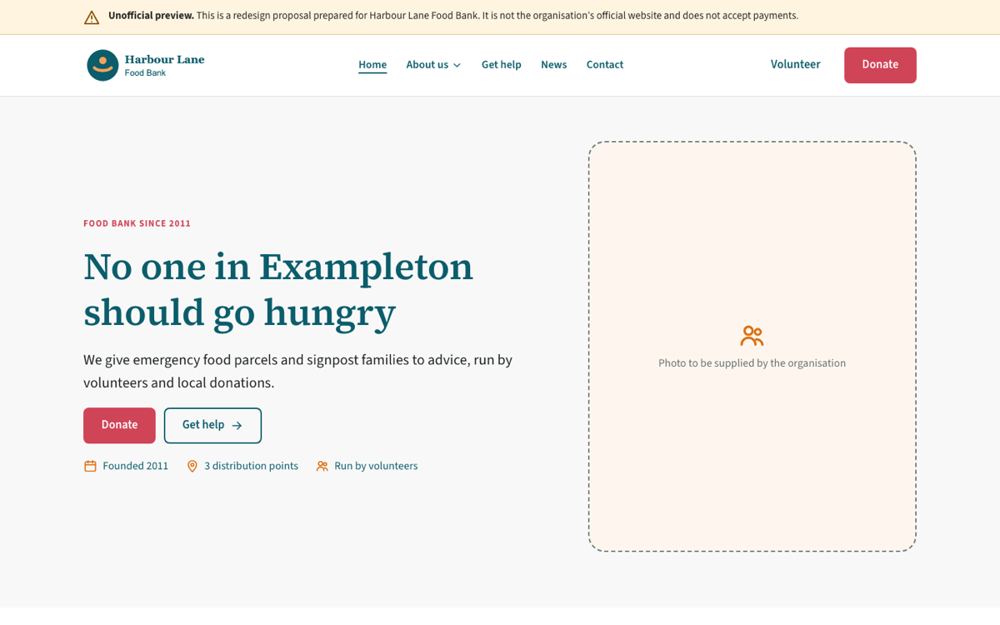
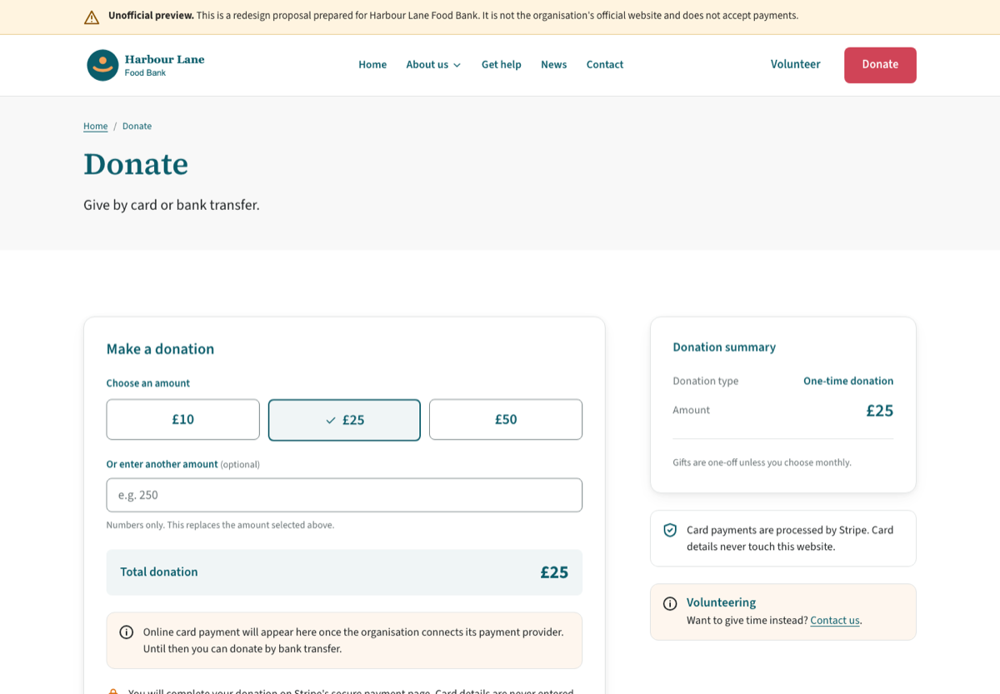
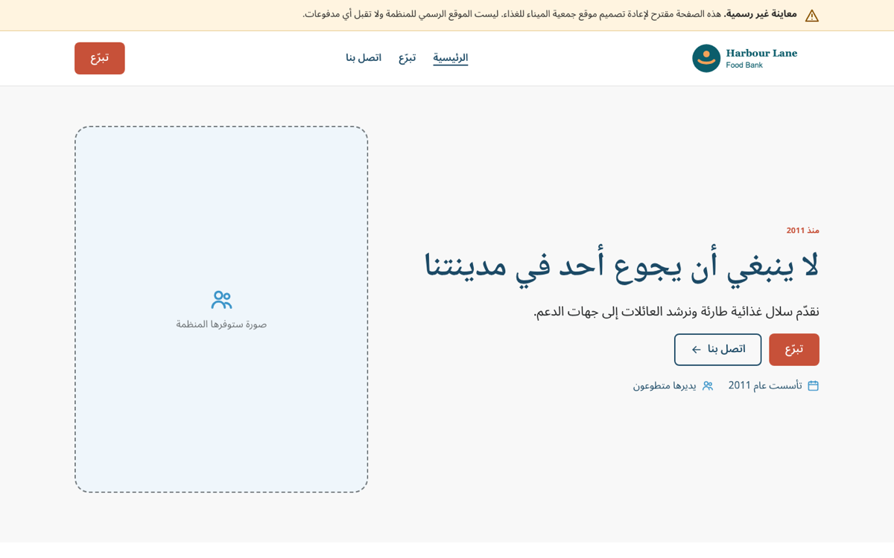

# charity-sites

**Paste a charity's website. Get back an accessible, fast, honest new website in the charity's own language, plus a guide showing how to connect the payment system it already uses.**

charity-sites is a set of [Agent Skills](https://agentskills.io) for Claude Code (and other agents that read `SKILL.md`). It turns one real redesign workflow, first built for a patient association in Türkiye, into a repeatable process anyone can run:

```
/charity-site https://example-charity.org
```

1. **Audit** — politely crawls the site; inventories every page, photo, colour, contact and bank detail; validates IBANs; detects the payment provider in use; lists broken pages and missing information.
2. **Build** — derives a WCAG-compliant palette from the logo, writes every section from the charity's own published text (each with its source URL), and renders a static site in the charity's language, right-to-left included.
3. **Handoff** — packages the site with a README in the charity's language (how to publish, how to connect *their* payment provider), a list of facts they must confirm, a content-source table, a zip, and a short approval email draft for **you** to review and send.

| Home | Donate | Right-to-left |
|---|---|---|
|  |  |  |

*Screenshots show the fictional test fixtures in `examples/`, not a real organisation.*

## Principles

These are enforced by the skills and, where possible, by code (`check.py` fails the build).

- **Nothing invented.** No new activities, statistics, testimonials, partners, medical claims or badges. Every content section carries its source URL. Missing facts become "Organization confirmation required" questions, never filler text.
- **Real dates, real names.** Old news keeps its date. An association stays an association.
- **The organisation's own photos only**, chosen for dignity and consent, never upscaled into a hero, never AI-generated people.
- **No card data on the charity's site.** Donors pick an amount, then pay on the provider's hosted page (Stripe, PayPal, iyzico, PayTR, Razorpay, Mollie, Donorbox… or the charity's existing donation page).
- **Accessible by construction.** WCAG 2.2 AA contrast computed for every colour pair, visible focus, 44 px targets, labelled fields, specific error messages, RTL via logical CSS, no information by colour alone.
- **Fast and portable.** Plain HTML, ~33 KB of CSS and ~9 KB of JavaScript. Runs from a folder or on any static host. No tracking, no cookies, no build toolchain to install.
- **Humans send email.** The skill drafts one personal approval email. It never sends on its own, never sends in bulk, never follows up automatically.
- **Preview until approved.** Every build is marked "unofficial preview", `noindex`, and cannot take payments until the organisation says yes.

## Install

### Claude Code plugin

```
/plugin marketplace add enis027/charity-sites
/plugin install charity-sites@charity-sites
```

Then run `/charity-site <url>` or just ask: *"This charity's site is hard to use, can you rebuild it? https://…"*.

### Other agents, or skills only

Copy the three folders in `skills/` into your agent's skills directory (for Claude Code: `~/.claude/skills/`). Each skill is self-contained with its own scripts and references.

### Requirements

- Python 3.9+ (standard library only)
- Optional: Chrome, Chromium or Edge for screenshots; Pillow, ImageMagick or macOS `sips` for resizing photos

## What the organisation receives

```
example-charity-website/
├── site/              ← upload this folder to any web host
├── source/site.json   ← all texts and settings (edit, then rebuild)
├── source/assets/     ← logo and photos
├── tools/build.py     ← rebuild + quality checks in one command
├── README.md          ← in their language: publish, connect payments, go live
├── OPEN-QUESTIONS.md  ← what they must confirm
└── SOURCES.md         ← where every section's text came from
```

## Repository layout

```
skills/
  charity-site-audit/     crawl.py + references: content integrity, photography, payment detection
  charity-site-build/     template (build.py, render.py, palette.py, CSS/JS, i18n) + check.py, screenshots.py
                          references: charity UX principles (cited), IA, site.json schema, i18n, visual QA
  charity-site-handoff/   package.py + references: payment providers, README template, outreach email
agents/content-integrity-reviewer.md   independent fact-check of the new site against the old one
commands/charity-site.md               /charity-site <url> runs all three skills
examples/fixture-en, fixture-ar        fictional test sites covering every component (LTR + RTL)
tests/                                 unit tests (palette, build, checks, crawler parsing)
```

## The research behind it

`skills/charity-site-build/references/charity-ux-principles.md` summarises what the evidence says about charity websites, including how strong each finding is and what the template does about it. Sources include Nielsen Norman Group's donation usability research, behavioural studies on suggested amounts, Baymard's checkout research, WCAG 2.2, the GOV.UK Design System, web.dev Core Web Vitals and the Dóchas Code of Conduct on Images and Messages.

## Responsible use

- Audit only public pages. The crawler respects `robots.txt`, identifies itself and waits between requests.
- Contact an organisation once, personally, at an address it publishes. Respect "no". Unsolicited bulk email is illegal in many countries and harms charities.
- Never publish a preview on a domain that resembles the organisation's, and never present it as official.
- The organisation owns its content and photos. The code in this repository is MIT-licensed; their content is not.

## Contributing

Translations of the interface strings (`skills/charity-site-build/template/i18n/`), new section types, payment-provider recipes for more countries, and accessibility fixes are especially welcome. See [CONTRIBUTING.md](CONTRIBUTING.md).

## License

MIT, for the code and documentation in this repository. See [LICENSE](LICENSE).
